<p align="center">
  
</p>

<h1 align="center">Monarch</h1>

<p align="center">
  <strong>A terminal multiplexer for AI coding agents that shows you which one needs you.</strong><br>
  Run Claude Code, Codex and your shells side by side, grouped by repository and worktree.<br>
  Keys, mouse, paste and colours reach your programs exactly as they would in a bare terminal.
</p>

<p align="center">
  <a href="https://github.com/cooksterj/monarch/actions/workflows/ci.yml"></a>
</p>

<p align="center">
  <a href="#install">Install</a> · <a href="#features">Features</a> · <a href="#how-it-compares">How it compares</a> · <a href="docs/guide.md">User guide</a>
</p>

```sh
brew tap cooksterj/monarch && brew trust cooksterj/monarch && brew install cooksterj/monarch/monarch
```

<picture>
  <source media="(max-width: 600px)" srcset="docs/assets/hero-phone.webp">
  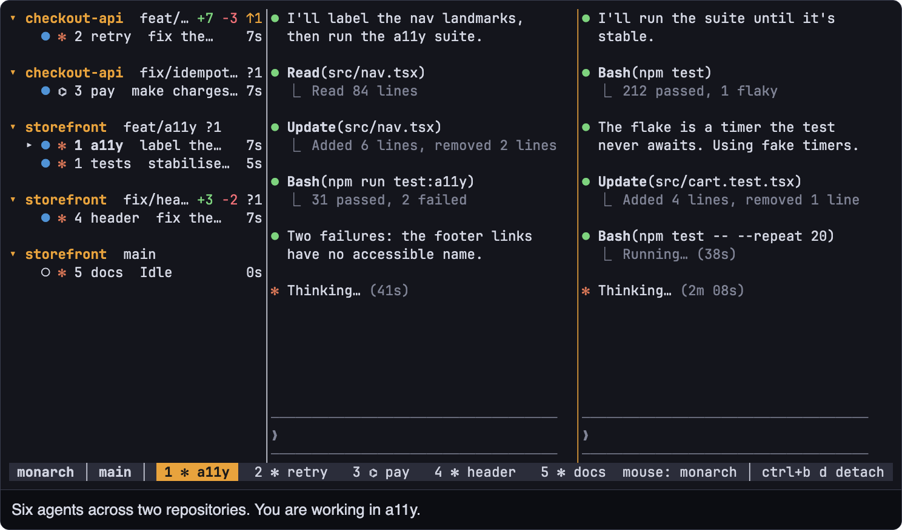
</picture>

<sub>Recorded from the real binary in a PTY. The agents are scripted, the repositories are disposable, and the captions and amber row highlight were added for the recording. [`scripts/capture_readme.py`](scripts/capture_readme.py) regenerates every image on this page.</sub>

> [!NOTE]
> **Pre-1.0.** Monarch is stable enough for daily use on macOS and Linux, and every feature shown here is available in the current release. Until 1.0, keys, configuration and the wire format may change between releases. See the [roadmap](docs/roadmap.md).

## Features

[Worktrees](#parallel-agents-in-isolated-worktrees) · [Sidebar](#every-agent-at-a-glance) · [Attention inbox](#an-inbox-for-agents-waiting-on-you) · [Agent state](#where-agent-state-comes-from) · [Terminal fidelity](#terminal-fidelity) · [Diff review](#built-in-diff-review) · [Detach and SSH](#detach-and-reattach-from-anywhere) · [Restore](#restore-after-a-crash) · [Automation](#automation-from-the-cli) · [Themes](#themes-and-key-presets)

### Parallel agents in isolated worktrees

`monarch new` creates a git worktree and opens a new tab in it, running an agent or a shell, so agents working in parallel never overwrite each other's changes.

```sh
monarch new feat/retry --agent claude --detached
monarch new fix/idempotency --agent codex --detached
monarch new feat/a11y --agent claude
```

From inside Monarch, `prefix N` opens the same action as a form. The prefix is `Ctrl-b`, and every key is [rebindable](docs/guide.md#keys).

<p align="center">
  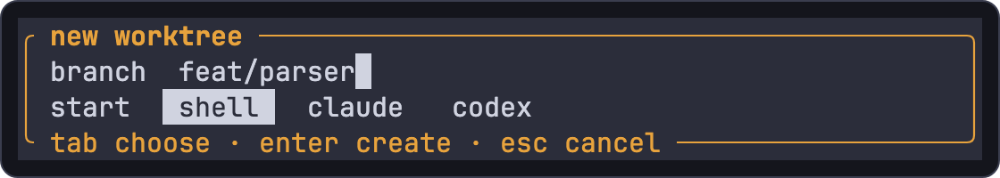
</p>

### Every agent at a glance

The sidebar groups panes by repository and worktree, derived from each pane's working directory with no configuration. Each row shows the agent's state, its program, its name, what it is doing and how long its current turn has taken. Each worktree's heading shows how it differs from its upstream.

<p align="center">
  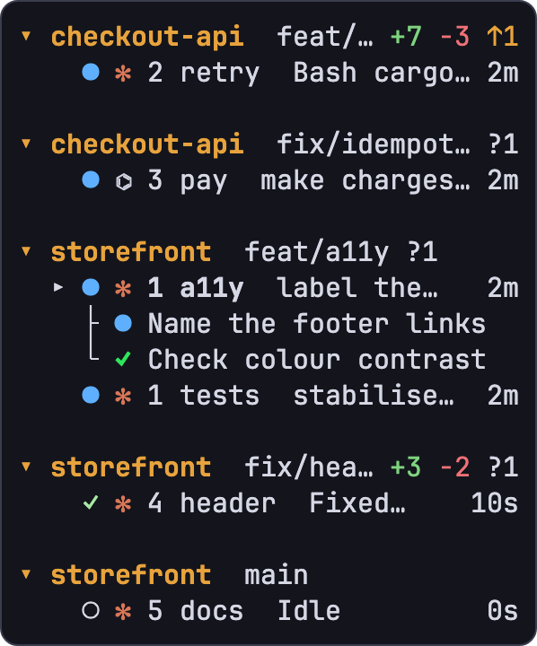
</p>

| State | | Worktree badge | |
|:---:|---|:---:|---|
| `●` | working | `+7` `−3` | lines added and removed |
| `◆` | blocked, waiting on you | `?1` | untracked files |
| `○` | idle | `↑1` `↓1` | commits ahead of and behind upstream |
| `✓` | done | | |
| `✗` | error | | |

**Sub-agents** appear as indented rows beneath the agent that started them, named by their task and marked with the same glyphs: Claude Code's sub-agents and teammates, and agents Codex spawns. A sub-agent's question blocks its parent, so it reaches the inbox like any other. Finished rows remain until your next prompt, so you can see what was done.

### An inbox for agents waiting on you

When an agent in another tab needs a decision, such as permission to run a command, an amber diamond appears on its row in the sidebar.

`prefix a` opens the attention inbox: every agent waiting on you, longest wait first, with its question or last message and how long it has been waiting. Press `y`, `n` or a number to answer; Monarch sends the reply to that agent in the form it expects, and you stay in your current pane. `Enter` jumps to the agent's pane instead, `prefix Tab` goes directly to the next blocked agent, and `prefix g` then `b` filters the pane list to blocked agents.

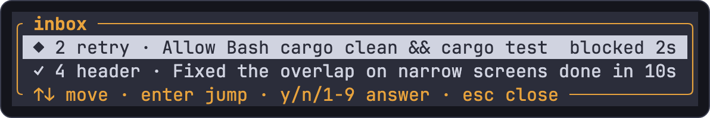

### Ask an agent about what you're reading

Select text with the mouse (code in vim, a stack trace, a log) and press `prefix e`. Type a prompt and pick an agent: your words and the selection, quoted with its `path:lines` where Monarch knows them, go to that agent as one message. `a` does the same from copy mode, the file viewer and the diff review. With nothing selected, only your words are sent. The list also offers new Claude Code or Codex agents, started beside your pane and given the prompt as their first message.

<p align="center">
  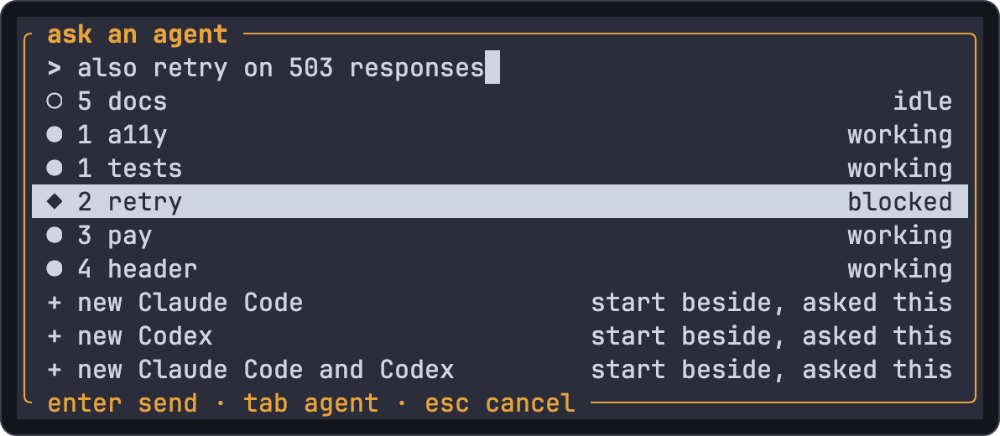
</p>

Monarch types into an agent only when it is at its prompt. Ask one that is working or waiting on you, and the prompt is queued and sent when the agent is ready, one per turn. The agent's sidebar row counts what is waiting (`+2`), and `prefix i` lists the queued prompts in order; press `1`–`9` there to drop one before it is sent.

<p align="center">
  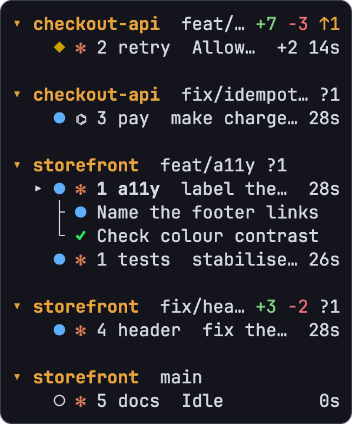
  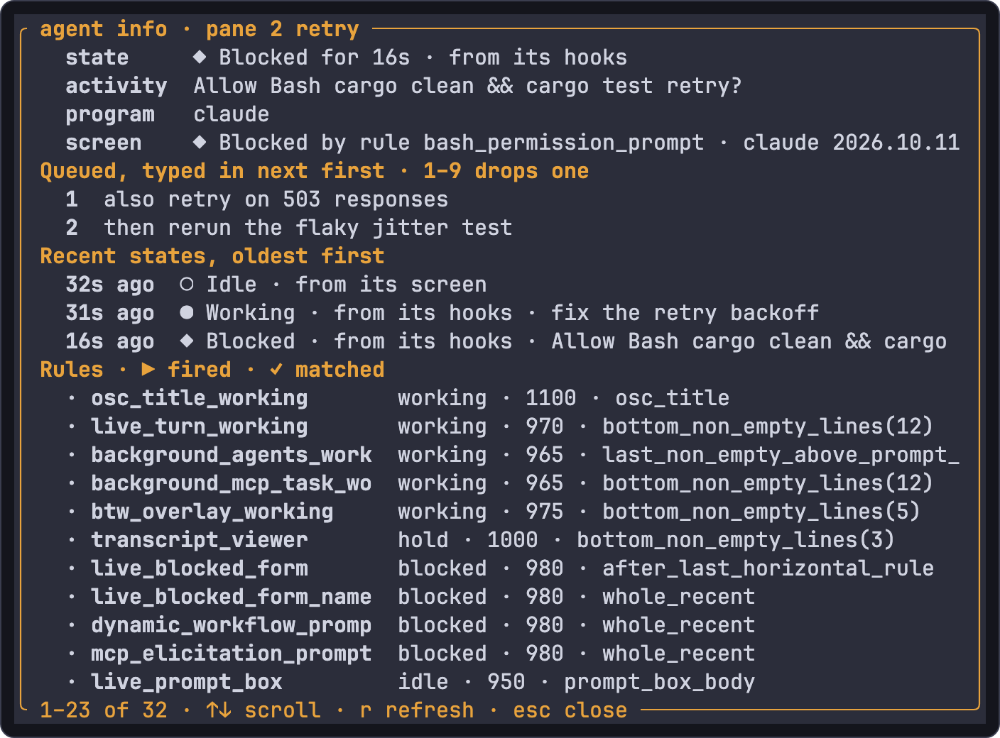
</p>

### Where agent state comes from

Agents report their own state. `monarch setup` installs hooks for Claude Code and Codex, backing up each file it edits. Other agents are recognised from terminal notifications and from what is on their screen.

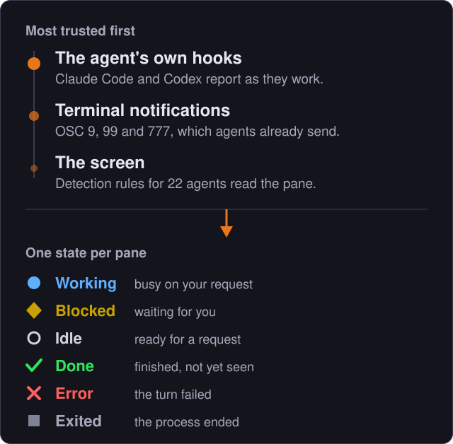

Every state can be explained. `prefix i` shows, for the current pane, the state and the signal that set it, how the detection rules read the screen, and the agent's recent state history. The view updates live while it is open.


The same information is available from the command line:

```text
$ monarch agent explain p2
pane p2 (tab 2) · claude
status    ◆ Blocked, from its hooks
activity  Allow Bash cargo clean && cargo test retry?
history    22s ago  ○ Idle      from its screen
           21s ago  ● Working   from its hooks  fix the retry backoff
            5s ago  ◆ Blocked   from its hooks  Allow Bash cargo clean && cargo test retry?
manifest  claude 2026.10.11.1
screen    ◆ Blocked (rule bash_permission_prompt)
```

### Terminal fidelity

Programs in a pane behave as they would in a bare terminal. Vim receives mouse events, Shift+Enter works in Claude Code, and a 1 MiB paste arrives intact. Monarch claims only the keys pressed after the prefix. Colour queries are answered by your real terminal, and panes run with `TERM=xterm-256color` and `TERM_PROGRAM=monarch`, so nothing impersonates your terminal.

CI verifies this with PTY harnesses that act as the host terminal. [One](scripts/smoke_input_matrix.py) sends a matrix of keys through the terminal core and compares what the pane receives byte for byte; others drive `monarch attach` through [mouse input](scripts/smoke_mouse.py) and through [detaching and restoring](scripts/smoke_restore.py).

Overhead is low. In a [20-pane benchmark](docs/bench/m6-twenty-panes.md) on an Apple M2 Max, with ten panes in other tabs printing a line every 20 ms, keystroke latency to the program was 87 µs at the median and 266 µs at p99. With all 20 panes idle, client and server together used 0.7 % CPU.

Known limitations: Kitty graphics and sixel images are not yet supported, and while Monarch has mouse capture, hold Shift to use your terminal's native selection.

### Built-in diff review

When an agent finishes, a green tick appears on its row. `prefix v` shows the pane's uncommitted changes file by file, so you can review the work before accepting it. Press `c` on a hunk to write a note; Monarch sends it to the agent's prompt with the file and hunk attached while you keep reading. `e` opens the file in `$EDITOR`.

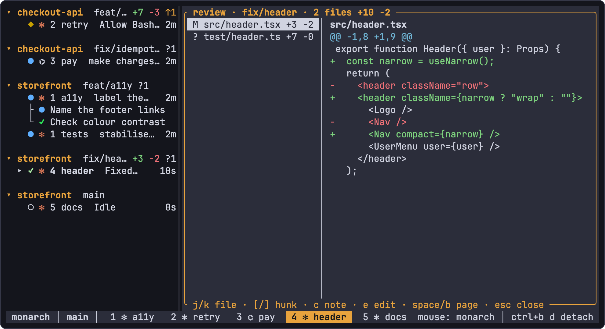

### Detach and reattach from anywhere

`prefix d` detaches, as does closing the terminal. The server keeps every agent running for as long as the machine is awake.

```text
$ monarch ls
main   6 panes, 5 tabs
```

On a machine that stays on, connect with `ssh` and run `monarch` to pick up where you left off. Several terminals can be attached to one session at once. Copying uses OSC 52, which reaches your local clipboard over SSH when your terminal permits clipboard access.

### Restore after a crash

If the server stops unexpectedly, after a reboot or a `kill -9`, the next `monarch` restores your tabs, splits and each pane's working directory. Agents that Monarch started resume their conversations: `claude --resume` for Claude Code, `codex resume` for Codex.

<picture>
  <source media="(max-width: 600px)" srcset="docs/assets/restored-phone.png">
  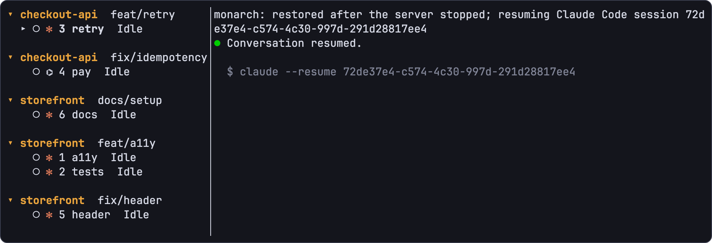
</picture>

An agent you started by hand returns as a shell in the same directory. As with tmux, running programs and their screens cannot outlive the server. `monarch kill` ends a session permanently.

### Automation from the CLI

Agents running in panes can use the same commands you do, so one agent can start, instruct and wait on another. `monarch setup` installs a skill that teaches them how.

```sh
monarch new feat-parser --agent claude --detached
monarch pane send p7 "Add a parser. Run cargo test before you stop." --enter
monarch agent wait p7 --timeout 600     # until p7 is blocked, done or failed
monarch agent read p7                   # what it said when it stopped
```

### Themes and key presets

The default theme follows your terminal's background, light or dark. Catppuccin, Tokyo Night and Gruvbox are built in, each in light and dark variants, and individual colours can be overridden. Themes apply only to Monarch's own interface; programs in panes keep their colours. Key bindings ship with `monarch`, `tmux` and `herdr` presets and can be changed individually.

<p align="center">
  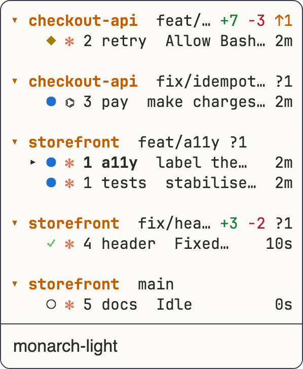
  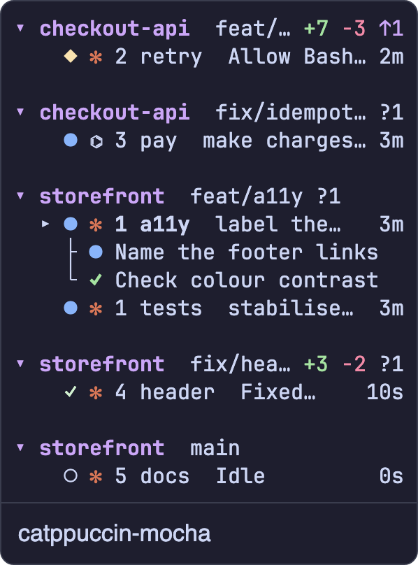
  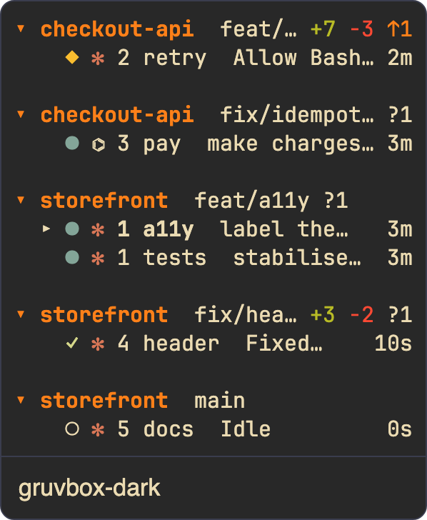
</p>

## How it compares

Monarch is the youngest and smallest project in this comparison. Several of these tools are more mature, and some offer features Monarch does not. A dash means the feature could not be found in that project's documentation, which does not prove it is absent. [Corrections are welcome](https://github.com/cooksterj/monarch/issues).

| | Monarch | [Herdr](https://github.com/herdrdev/herdr) | [TUIOS](https://github.com/Gaurav-Gosain/tuios) | [cmux](https://github.com/manaflow-ai/cmux) | [Zellij](https://github.com/zellij-org/zellij) | [tmux](https://github.com/tmux/tmux) | [Claude Squad](https://github.com/smtg-ai/claude-squad) |
|---|---|---|---|---|---|---|---|
| **Runs in** | your terminal | your terminal | your terminal | its own app | your terminal, or a browser | your terminal | your terminal |
| **Keys** | prefix | prefix | modal and prefix | Cmd/Ctrl chords | modal | prefix | list keys, then attach |
| **Agent state from** | hooks, then notifications, then screen | screen and process, optional integrations | hooks, then process and screen | hooks | plugin | — | screen |
| **List of waiting agents** | ✓ | partly: sorted sidebar | ✓ | ✓ | — | — | partly: all sessions |
| **Answer from that list** | ✓ | — | ✓ | ✓ | — | — | — |
| **Detach, keep running** | ✓ | ✓ | ✓ | opt-in | ✓ | ✓ | through tmux |
| **Restore layout after a restart** | ✓ | ✓ | ✓ | after a relaunch | ✓ | plugin | partly: worktree only |
| **Resume agent conversations** | agents it started | supported agents | ✓ | after a relaunch | — | — | — |
| **Creates git worktrees** | ✓ | ✓ | ✓ | — | plugin | — | ✓ |
| **Built-in diff review** | ✓ | plugin | ✓ | ✓ | — | — | ✓ |
| **Panes grouped by repository** | ✓ | ✓ | ✓ | manual groups | — | — | flat list |
| **Wait on another agent from the CLI** | ✓ | ✓ | ✓ | — | — | — | — |
| **Agents on several machines in one view** | — | ✓ | ✓ | ✓ | — | — | — |
| **Plugins** | — | ✓ | ✓ | custom sidebars | ✓ | via TPM | — |
| **Platforms** | macOS, Linux | macOS, Linux, Windows | macOS, Linux, Windows, BSD | macOS | macOS, Linux, Windows | macOS, Linux, BSD | macOS, Linux |
| **License** | MIT or Apache-2.0 | Apache-2.0 | MIT | GPL-3.0+, some parts BUSL-1.1 | MIT | ISC | AGPL-3.0 |
| **Latest release** | v0.1.8 | v0.9.5 | v0.12.1 | v0.65.2.2 | v0.45.1 | 3.8 | v1.0.20 |

<sub>Checked against each project's docs on 2026-11-05. The cmux column describes its macOS app; cmux also has a separate terminal multiplexer, cmux TUI. These tools move quickly: Zellij's unreleased changes already add an inbox and agent status.</sub>

**Another tool may suit you better if you want:**

- the multiplexer already installed on every server: **tmux**.
- layouts, floating panes, a web client and a plugin system, with or without agents: **Zellij**.
- the established agent multiplexer, with Windows support, plugins and several machines in one window: **Herdr**.
- a tiling window manager with modes, BSP layouts and kitty graphics: **TUIOS**.
- a native macOS app with a built-in browser: **cmux**.
- a simple session list on top of tmux: **Claude Squad**.

**Monarch is a good fit if you want** prefix-only keys that leave everything else to your programs, input handling verified byte for byte in CI, agent state sourced first from the agent's own hooks, and an inbox you can answer from.

<details>
<summary>Sources for the table</summary>

- **Herdr:** [concepts](https://herdr.dev/tui/docs/concepts/), [CLI reference](https://herdr.dev/tui/docs/cli-reference/), [plugins](https://herdr.dev/tui/docs/plugins/), [keyboard](https://herdr.dev/tui/docs/keyboard/), [install](https://herdr.dev/tui/docs/install/), [third-party diff plugin](https://github.com/persiyanov/herdr-reviewr)
- **TUIOS:** [agents](https://github.com/Gaurav-Gosain/tuios/blob/main/docs/AGENT_STATE.md), [sessions](https://github.com/Gaurav-Gosain/tuios/blob/main/docs/SESSIONS.md), [keys](https://github.com/Gaurav-Gosain/tuios/blob/main/docs/KEYBINDINGS.md)
- **cmux:** [README](https://github.com/manaflow-ai/cmux), [agent hooks](https://github.com/manaflow-ai/cmux/blob/main/docs/agent-hooks.md), [feed](https://github.com/manaflow-ai/cmux/blob/main/docs/feed.md), [license](https://github.com/manaflow-ai/cmux/blob/main/LICENSE)
- **Zellij:** [session resurrection](https://zellij.dev/documentation/session-resurrection.html), [plugins](https://zellij.dev/documentation/plugins.html), [FAQ](https://zellij.dev/documentation/faq.html)
- **tmux:** [README](https://github.com/tmux/tmux), [tmux-resurrect](https://github.com/tmux-plugins/tmux-resurrect)
- **Claude Squad:** [README](https://github.com/smtg-ai/claude-squad)

</details>

## Install

Monarch runs on macOS and Linux. Each release ships prebuilt binaries for Apple silicon and Intel Macs and for x86_64 and aarch64 Linux (static, so any distribution works).

**Homebrew**

The tap is [`cooksterj/homebrew-monarch`](https://github.com/cooksterj/homebrew-monarch). Homebrew 7 requires third-party taps to be trusted before it loads their formulas; earlier versions have no `brew trust` and skip that step. Use the fully qualified name: `brew install monarch` installs an unrelated program, the Monarch launcher cask.

```sh
brew tap cooksterj/monarch && brew trust cooksterj/monarch && brew install cooksterj/monarch/monarch
```

**Shell installer**

Downloads the binary for your platform into `~/.cargo/bin` (Rust is not required) and warns you if that directory is not on your `PATH`:

```sh
curl --proto '=https' --tlsv1.2 -LsSf https://github.com/cooksterj/monarch/releases/latest/download/monarch-mux-installer.sh | sh
```

Each release also publishes tarballs and checksums on the [releases page](https://github.com/cooksterj/monarch/releases) for manual installation.

**From source**

With a stable Rust toolchain, 1.88 or newer:

```sh
cargo install --git https://github.com/cooksterj/monarch --tag v0.1.8   # a release
cargo install --git https://github.com/cooksterj/monarch                # latest main
cargo install --path . --locked                                         # from a clone
```

The package is named `monarch-mux` because `monarch` was already taken; the binary is `monarch` in every case.

**First run**

```sh
monarch setup    # let Claude Code and Codex report their state; installs the Monarch skill
monarch doctor   # check the whole setup, with a fix for anything missing
monarch          # attach to the session `main`, starting it if needed
```

`monarch setup` adds hooks to `~/.claude/settings.json` and `~/.codex/config.toml` (honouring `CLAUDE_CONFIG_DIR` and `CODEX_HOME`), backs up each file first and changes nothing else. `--dry-run` previews the changes; `--uninstall` reverts them. The hooks have no effect outside Monarch. Codex asks you to approve new hooks in `/hooks`.

**Upgrading**

Run `brew upgrade cooksterj/monarch/monarch` or the installer again. The hooks call whichever `monarch` is on your `PATH`, so they pick up the new version automatically. A running session keeps the build it started with; if the new client refuses to attach to it, the error explains how to restart the session with its tabs and conversations restored.

On first attach, a welcome screen lists the essential keys.

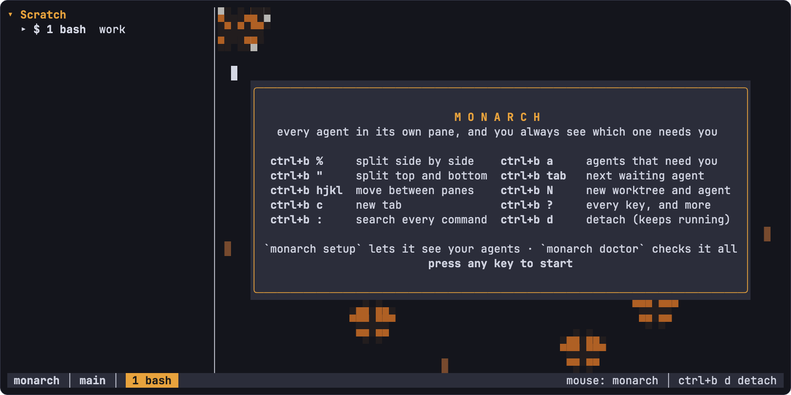

## Reference

<details>
<summary><strong>Keys</strong></summary>

Every command starts with the prefix, `Ctrl-b`. Press it and pause to see all available keys.

| Keys | Action |
|---|---|
| `prefix %` / `prefix "` | split right / down |
| `prefix h j k l` | move focus |
| `prefix c`, `prefix 1`–`9` | new tab, go to a tab |
| `prefix !` / `prefix &` | break the pane out into its own tab / close the tab |
| drag a divider | resize panes; the sidebar's edge resizes the sidebar |
| `prefix ,` / `prefix .` | rename the tab / the focused pane (e.g. two `claude` tabs → `api`, `web`) |
| `prefix a` | attention inbox: every agent waiting on you |
| `prefix Tab` | jump to the next agent waiting on a decision |
| `prefix i` | agent info: the signal, the rule that fired and the last few states |
| `prefix g`, then `b` `w` `i` `d` | go to a pane; narrow to blocked, working, idle or done agents |
| `prefix A` | launch Claude Code or Codex in a new tab, here |
| `prefix e` | ask an agent about the selected text: your prompt plus the selection, quoted |
| `prefix N` | new worktree: branch name, then shell, Claude Code or Codex |
| `prefix s` | projects: every worktree |
| `prefix v` | review the focused pane's uncommitted changes |
| `prefix f` | view a file from the checkout with syntax highlighting; `V` selects lines, `a` asks an agent (or `monarch view <file>` from the shell, or double-click a file name first) |
| `prefix S` | sessions |
| `prefix [` | copy mode |
| `prefix :` | command palette |
| `prefix d` | detach |
| `prefix ?` | help: every key, mouse gesture and command |

</details>

<details>
<summary><strong>Commands</strong></summary>

```sh
monarch                 # attach to the session `main`, starting it if needed
monarch work            # the session `work`, started if it isn't running
monarch ls              # running sessions
monarch new feat/x --agent claude   # a worktree for branch feat/x, with Claude Code in it
```

Read-only commands:

| Command | What it tells you |
|---|---|
| `monarch ls` | running sessions, with their panes, tabs and whether one is attached |
| `monarch agent explain` | every pane, its program and its agent's state, with where the state came from |
| `monarch agent explain p3` | one pane in detail: the states it went through lately, every detection rule and the text it matched |
| `monarch agent wait p3 --timeout 600` | waits until pane `p3`'s agent needs you, then prints its status |
| `monarch agent read p3` | the last thing pane `p3`'s agent said, in full (its screen, for an agent without hooks) |
| `monarch doctor` | the whole setup (binary, config, hooks, skill, git, terminal, sessions), with fixes |
| `monarch keys` | every key binding after the prefix |
| `monarch config path` / `default` / `check` | where the config is, every default, whether yours is valid |
| `monarch setup --dry-run` | what `monarch setup` would change |

The `agent` commands use the session you're in, or `main` outside Monarch; `-s <session>` picks another. `monarch <command> --help` explains any command.

</details>

**[The user guide](docs/guide.md)** covers everything in detail: agents and their states, the inbox, worktrees and review, copy mode and the mouse, sessions and restore, every key, rebinding, configuration and themes, and how agents can drive Monarch.

## Development

```sh
just check   # fmt, clippy, file-size lint, tests
```

See [`CLAUDE.md`](CLAUDE.md) for code conventions and [`docs/`](docs/README.md) for design, architecture and benchmarks. Contributions follow [`CONTRIBUTING.md`](CONTRIBUTING.md).

## Credits

Monarch's agent detection rules are taken unmodified from [Herdr](https://github.com/herdrdev/herdr) under the Apache License 2.0; see the [attribution](crates/monarch-detect/manifests/ATTRIBUTION.md).

## License

Licensed under either of [Apache License 2.0](LICENSE-APACHE) or [MIT](LICENSE-MIT) at your option.
