<p align="center">
  
</p>

<h1 align="center">Monarch</h1>

<p align="center">
  <strong>Every agent in its own pane, and you always see which one needs you.</strong><br>
  A terminal multiplexer for Claude Code, Codex and your shells.<br>
  Keys, mouse, paste and colours reach your programs as they would in a bare terminal.
</p>

<p align="center">
  <a href="https://github.com/cooksterj/monarch/actions/workflows/ci.yml"></a>
</p>

<p align="center">
  <a href="#install">Install</a> · <a href="#a-day-with-six-agents">A day with six agents</a> · <a href="#how-it-compares">How it compares</a> · <a href="docs/guide.md">User guide</a>
</p>

```sh
brew tap cooksterj/monarch && brew trust cooksterj/monarch && brew install cooksterj/monarch/monarch
```

<picture>
  <source media="(max-width: 600px)" srcset="docs/assets/hero-phone.webp">
  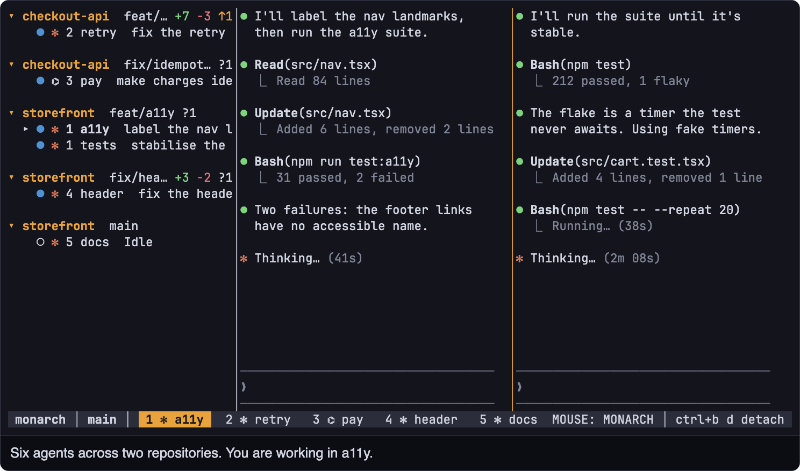
</picture>

<sub>The real binary, recorded in a PTY. The agents are scripted, the repositories are throwaway, and the captions and amber ring are added for the recording. [`scripts/readme_shots.py`](scripts/readme_shots.py) regenerates every capture on this page.</sub>

> [!NOTE]
> **Early.** Monarch is usable day to day on macOS and Linux, and everything shown here works today. Versions before 1.0 may still change keys, config and the wire format between releases. [Progress is in the plan](docs/plan.md).

## A day with six agents

[09:02 Worktrees](#0902-start-the-first-three) · [09:14 Inbox](#0914-one-of-them-needs-you) · [10:20 Fidelity](#1020-you-open-vim-in-the-next-pane) · [11:30 Review](#1130-one-of-them-says-its-done) · [12:10 Detach](#1210-go-to-lunch) · [13:05 SSH](#1305-pick-it-up-from-somewhere-else) · [15:40 Restore](#1540-the-server-dies) · [16:45 CLI](#1645-let-an-agent-run-the-next-one) · [17:30 Themes](#1730-someone-asks-what-theme-that-is)

### 09:02 Start the first three

Each one gets its own git worktree and tab, so they can't overwrite each other's work.

```sh
monarch new feat/retry --agent claude --detached
monarch new fix/idempotency --agent codex --detached
monarch new feat/a11y --agent claude
```

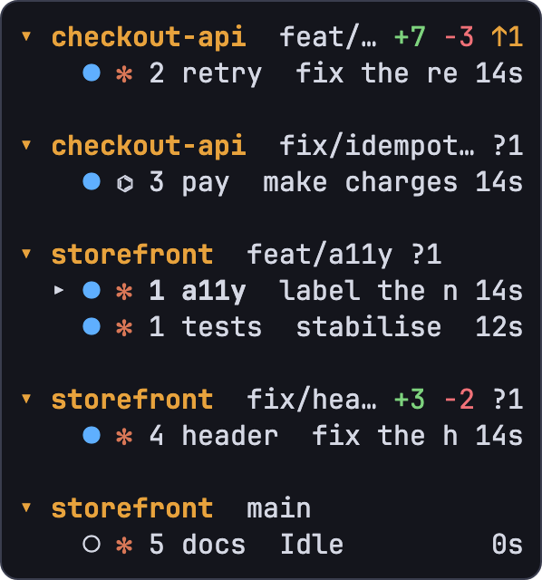

Nothing needs configuring. The sidebar works out the repository and worktree from each pane's directory, then shows how each checkout differs: `+7` `−3` lines changed, `?1` new files, `↑1` commits to push.

Already inside Monarch? `prefix N` does the same from a form. The prefix is `Ctrl-b`, and every key is [rebindable](docs/guide.md#keys).

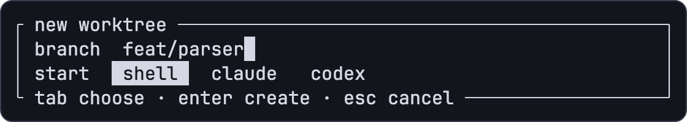

<br clear="right">

### 09:14 One of them needs you

You're working in `a11y`. In another tab, `retry` wants to run a command, and an amber diamond appears on its row in the sidebar.

`prefix a` opens the inbox: every agent waiting on you, longest wait first, with the question it asked or the last thing it said and how long it has been waiting. Type `y` or `n` and the answer goes to that agent in the form it expects, while you stay where you are. `Enter` jumps to its pane instead, and `prefix Tab` goes straight to the next blocked agent.

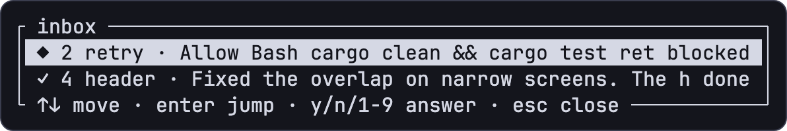

Monarch knew because the agent told it. `monarch setup` adds hooks to Claude Code and Codex, backing up each file it edits. Other agents are recognised from terminal notifications and from their screen.

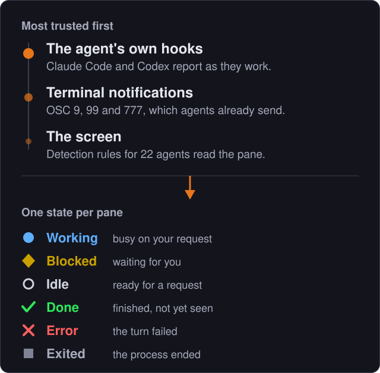

You can always ask why:

```text
$ monarch agent explain p2
pane p2 (tab 2) · claude
status    ◆ Blocked, from its hooks
activity  Allow Bash cargo clean && cargo test retry?
manifest  claude 2026.10.11.1
screen    ◆ Blocked (rule bash_permission_prompt)
```

### 10:20 You open vim in the next pane

Monarch stays out of its way. Vim gets its mouse, Shift+Enter still works in Claude Code, and a 1 MiB paste arrives in one piece. Only the keys after the prefix are Monarch's. Colour queries get your real terminal's answer, and panes get `TERM=xterm-256color` and `TERM_PROGRAM=monarch`, so nothing pretends to be your terminal.

CI checks this with PTY harnesses that play the host terminal. [One](scripts/spike3_input_matrix.py) types a matrix of keys at the terminal core and compares what the pane receives byte for byte. Others drive `monarch attach` through the [mouse](scripts/spike5_mouse_smoke.py), and through [detaching and restoring](scripts/spike6_restore_smoke.py).

It's quick, too. In a [20-pane benchmark](docs/bench/m6-twenty-panes.md) on an Apple M2 Max, with ten panes printing a line every 20 ms in other tabs, a keystroke reached the program in 87 µs at the median and 266 µs at p99. With all 20 idle, client and server together used 0.7 % CPU.

A few things don't pass through yet. Kitty graphics and sixel images aren't supported, undercurl and dotted underlines draw as plain underlines, and while Monarch has the mouse you hold Shift to use your terminal's own selection.

### 11:30 One of them says it's done

A green tick appears on `header`'s row. `prefix v` shows its uncommitted changes file by file, so you can read them before you believe it. Spot something off, press `c`, type a line, and the note lands in `header`'s prompt with the file, the hunk and your words, while you keep reading. `e` opens the file in `$EDITOR`.

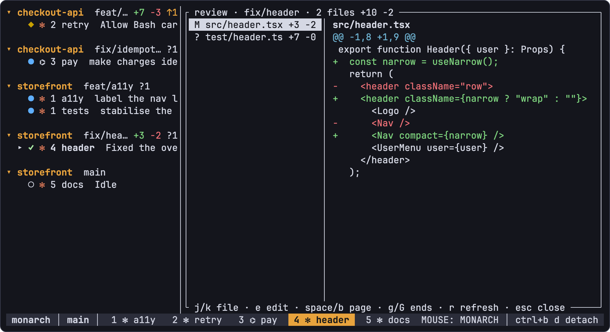

### 12:10 Go to lunch

`prefix d` detaches, and closing the terminal does the same. The server keeps every agent running for as long as its machine stays awake.

```text
$ monarch ls
main   6 panes, 5 tabs
```

### 13:05 Pick it up from somewhere else

If Monarch runs on a machine that stays on, `ssh` in and run `monarch`. Two terminals can be attached at once. Copying uses OSC 52, which reaches your local clipboard over SSH if your terminal allows clipboard access.

### 15:40 The server dies

Say a reboot, or a stray `kill -9`. The next `monarch` brings back your tabs, your splits and each pane's working directory. Agents Monarch started resume their conversations: `claude --resume` for Claude Code, `codex resume` for Codex.

<picture>
  <source media="(max-width: 600px)" srcset="docs/assets/restored-phone.png">
  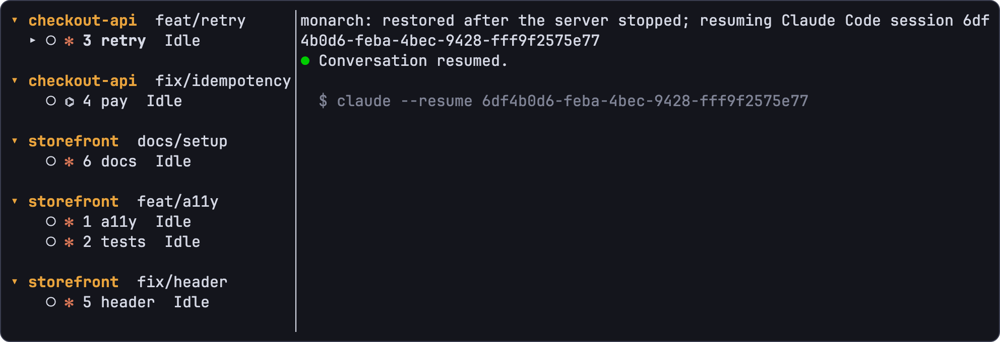
</picture>

An agent you started by hand comes back as a shell in the same directory. Running programs and their screens can't survive the server, as with tmux. `monarch kill` ends a session for good.

### 16:45 Let an agent run the next one

Agents in panes can use the same commands you do. `monarch setup` installs a skill that teaches them how.

```sh
monarch new feat-parser --agent claude --detached
monarch pane send p7 "Add a parser. Run cargo test before you stop." --enter
monarch agent wait p7 --timeout 600     # until p7 is blocked, done or failed
monarch agent read p7                   # what it said when it stopped
```

### 17:30 Someone asks what theme that is

Monarch's own, which follows your terminal's background, light or dark. Catppuccin, Tokyo Night and Gruvbox are built in too, each in both, and you can override single colours. Monarch colours only its own chrome; programs in panes keep theirs. Keys are as easy to change, with `monarch`, `tmux` and `herdr` presets.

<p align="center">
  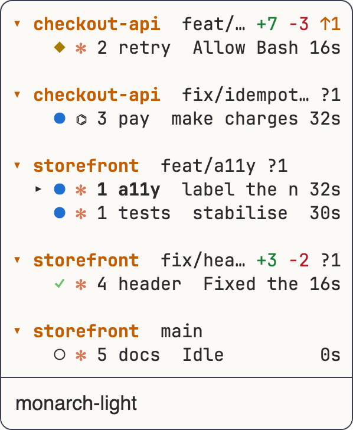
  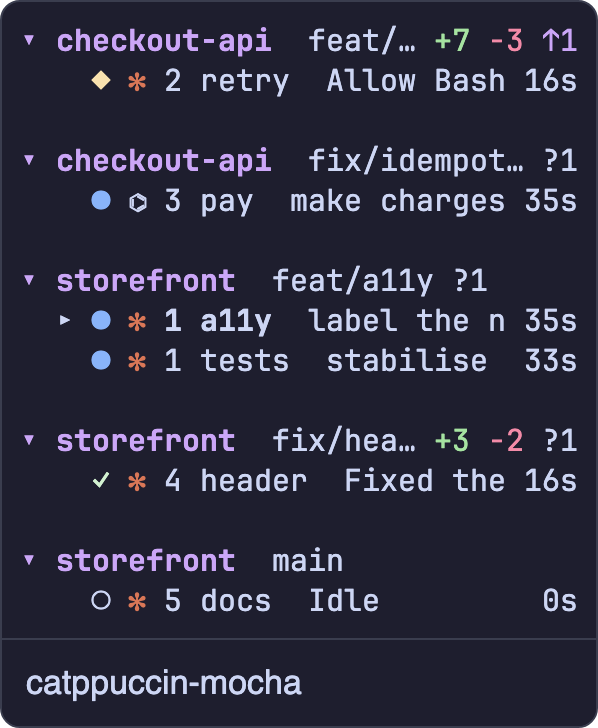
  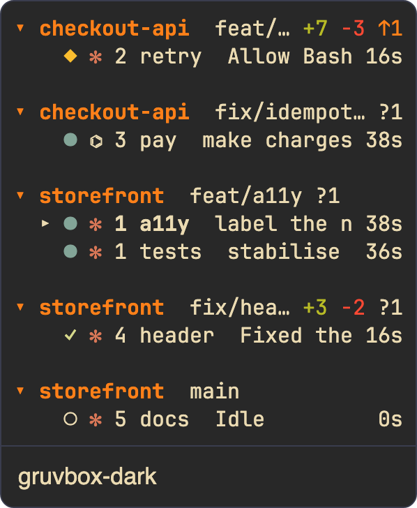
</p>

## How it compares

Monarch is about two weeks old and the smallest project here. Several of these tools are further along, and some do things Monarch doesn't. A dash means we couldn't find the feature in that project's docs, which doesn't prove it's absent. [Corrections are welcome](https://github.com/cooksterj/monarch/issues).

| | Monarch | [Herdr](https://github.com/herdrdev/herdr) | [TUIOS](https://github.com/Gaurav-Gosain/tuios) | [cmux](https://github.com/manaflow-ai/cmux) | [Zellij](https://github.com/zellij-org/zellij) | [tmux](https://github.com/tmux/tmux) | [Claude Squad](https://github.com/smtg-ai/claude-squad) |
|---|---|---|---|---|---|---|---|
| **Runs in** | your terminal | your terminal | your terminal | its own app | your terminal, or a browser | your terminal | your terminal |
| **Keys** | prefix | prefix | modal and prefix | Cmd/Ctrl chords | modal | prefix | list keys, then attach |
| **Agent state from** | hooks, then notifications, then screen | screen and process, optional integrations | hooks, then process and screen | hooks | plugin | — | screen |
| **List of waiting agents** | ✓ | partly: sorted sidebar | ✓ | ✓ | — | — | partly: all sessions |
| **Answer from that list** | ✓ | — | ✓ | ✓ | — | — | — |
| **Detach, keep running** | ✓ | ✓ | ✓ | opt-in | ✓ | ✓ | through tmux |
| **Restore layout after a restart** | ✓ | ✓ | ✓ | after a relaunch | ✓ | plugin | partly: worktree only |
| **Resume agent conversations** | agents it started | supported agents | ✓ | after a relaunch | — | — | — |
| **Creates git worktrees** | ✓ | ✓ | ✓ | — | plugin | — | ✓ |
| **Built-in diff review** | ✓ | plugin | ✓ | ✓ | — | — | ✓ |
| **Panes grouped by repository** | ✓ | ✓ | ✓ | manual groups | — | — | flat list |
| **Wait on another agent from the CLI** | ✓ | ✓ | ✓ | — | — | — | — |
| **Agents on several machines in one view** | — | ✓ | ✓ | ✓ | — | — | — |
| **Plugins** | — | ✓ | ✓ | custom sidebars | ✓ | via TPM | — |
| **Platforms** | macOS, Linux | macOS, Linux, Windows | macOS, Linux, Windows, BSD | macOS | macOS, Linux, Windows | macOS, Linux, BSD | macOS, Linux |
| **License** | MIT or Apache-2.0 | Apache-2.0 | MIT | GPL-3.0+, some parts BUSL-1.1 | MIT | ISC | AGPL-3.0 |
| **Latest release** | none yet | v0.9.5 | v0.12.1 | v0.65.2.2 | v0.45.1 | 3.8 | v1.0.20 |

<sub>Checked against each project's docs on 2026-11-05. The cmux column describes its macOS app; cmux also has a separate terminal multiplexer, cmux TUI. These tools move quickly: Zellij's unreleased changes already add an inbox and agent status.</sub>

**Choose something else if:**

- you want the tool that's already on every server: **tmux**.
- you want layouts, floating panes, a web client and a plugin system, with or without agents: **Zellij**.
- you want the established agent multiplexer, with Windows, plugins and several machines in one window: **Herdr**.
- you want a tiling window manager with modes, BSP layouts and kitty graphics: **TUIOS**.
- you're on a Mac and prefer a native app with a built-in browser: **cmux**.
- you want a simple list of sessions on top of tmux: **Claude Squad**.

**Choose Monarch if** you want prefix-only keys that leave everything else to your programs, key handling that CI compares byte for byte, agent state that starts from the agent's own hooks, and an inbox you can answer from.

<details>
<summary>Sources for the table</summary>

- **Herdr:** [concepts](https://herdr.dev/tui/docs/concepts/), [CLI reference](https://herdr.dev/tui/docs/cli-reference/), [plugins](https://herdr.dev/tui/docs/plugins/), [keyboard](https://herdr.dev/tui/docs/keyboard/), [install](https://herdr.dev/tui/docs/install/), [third-party diff plugin](https://github.com/persiyanov/herdr-reviewr)
- **TUIOS:** [agents](https://github.com/Gaurav-Gosain/tuios/blob/main/docs/AGENT_STATE.md), [sessions](https://github.com/Gaurav-Gosain/tuios/blob/main/docs/SESSIONS.md), [keys](https://github.com/Gaurav-Gosain/tuios/blob/main/docs/KEYBINDINGS.md)
- **cmux:** [README](https://github.com/manaflow-ai/cmux), [agent hooks](https://github.com/manaflow-ai/cmux/blob/main/docs/agent-hooks.md), [feed](https://github.com/manaflow-ai/cmux/blob/main/docs/feed.md), [license](https://github.com/manaflow-ai/cmux/blob/main/LICENSE)
- **Zellij:** [session resurrection](https://zellij.dev/documentation/session-resurrection.html), [plugins](https://zellij.dev/documentation/plugins.html), [FAQ](https://zellij.dev/documentation/faq.html)
- **tmux:** [README](https://github.com/tmux/tmux), [tmux-resurrect](https://github.com/tmux-plugins/tmux-resurrect)
- **Claude Squad:** [README](https://github.com/smtg-ai/claude-squad)

</details>

## Install

Monarch runs on macOS and Linux. Each release ships prebuilt binaries for Apple silicon and Intel Macs and for x86_64 and aarch64 Linux (static, so any distribution works).

**Homebrew**

The tap is [`cooksterj/homebrew-monarch`](https://github.com/cooksterj/homebrew-monarch). Homebrew 7 asks you to tap and trust third-party taps before it will load their formulas; older Homebrews have no `brew trust` and skip that step. Use the full name: a bare `brew install monarch` is a different program, the Monarch launcher cask.

```sh
brew tap cooksterj/monarch && brew trust cooksterj/monarch && brew install cooksterj/monarch/monarch
```

**Shell installer**

Downloads the binary for your machine into `~/.cargo/bin` (no Rust needed) and tells you if that isn't on your `PATH`:

```sh
curl --proto '=https' --tlsv1.2 -LsSf https://github.com/cooksterj/monarch/releases/latest/download/monarch-mux-installer.sh | sh
```

Every release also attaches the tarballs and their checksums on the [releases page](https://github.com/cooksterj/monarch/releases), if you would rather unpack one yourself.

**From source**

With a stable Rust toolchain, 1.88 or newer:

```sh
cargo install --git https://github.com/cooksterj/monarch --tag v0.1.0   # a release
cargo install --git https://github.com/cooksterj/monarch                # latest main
cargo install --path . --locked                                         # from a clone
```

The package is `monarch-mux` (plain `monarch` was taken), the binary is `monarch` either way.

Then, once:

```sh
monarch setup    # let Claude Code and Codex report their state; installs the Monarch skill
monarch doctor   # check the whole setup, with a fix for anything missing
monarch          # attach to the session `main`, starting it if needed
```

`monarch setup` adds hooks to `~/.claude/settings.json` and `~/.codex/config.toml` (honouring `CLAUDE_CONFIG_DIR` and `CODEX_HOME`), touching nothing else and backing each file up first. `--dry-run` shows what would change; `--uninstall` removes it all. Outside Monarch the hooks do nothing. Codex asks you to trust new hooks in `/hooks`.

To upgrade, run `brew upgrade cooksterj/monarch/monarch` or the installer again. The hooks run the `monarch` on your `PATH`, so they follow it. A running session keeps the build it started with; when the new one refuses to attach to it, the message says how to restart the session with its tabs and conversations restored.

The first time you attach, the welcome screen shows the few keys you need.

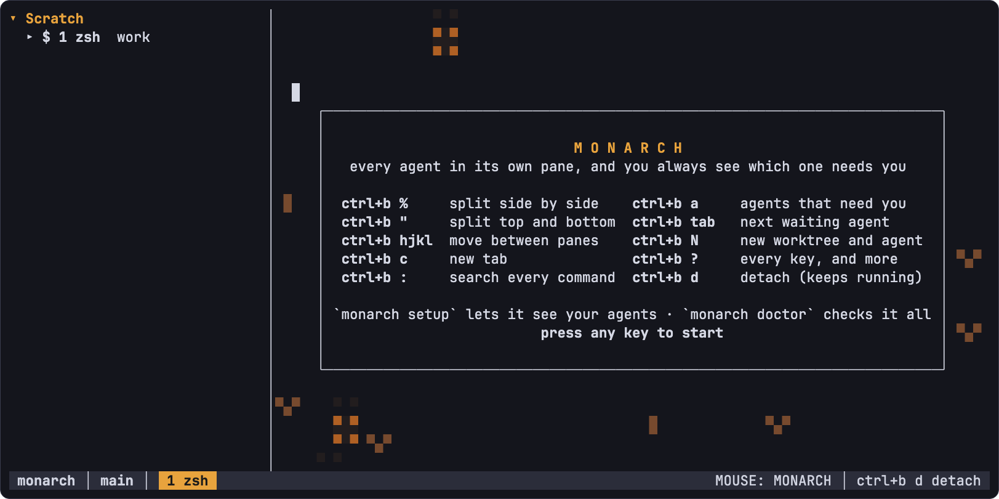

## Reference

<details>
<summary><strong>Keys</strong></summary>

Everything starts with the prefix, `Ctrl-b`. Press it and wait to see every key.

| Keys | Action |
|---|---|
| `prefix %` / `prefix "` | split right / down |
| `prefix h j k l` | move focus |
| `prefix c`, `prefix 1`–`9` | new tab, go to a tab |
| `prefix ,` / `prefix .` | rename the tab / the focused pane (e.g. two `claude` tabs → `api`, `web`) |
| `prefix a` | attention inbox: every agent waiting on you |
| `prefix Tab` | jump to the next agent waiting on a decision |
| `prefix N` | new worktree: branch name, then shell, Claude Code or Codex |
| `prefix s` | projects: every worktree |
| `prefix v` | review the focused pane's uncommitted changes |
| `prefix S` | sessions |
| `prefix [` | copy mode |
| `prefix :` | command palette |
| `prefix d` | detach |
| `prefix ?` | help: every key, mouse gesture and command |

</details>

<details>
<summary><strong>Commands</strong></summary>

```sh
monarch                 # attach to the session `main`, starting it if needed
monarch work            # the session `work`, started if it isn't running
monarch ls              # running sessions
monarch new feat/x --agent claude   # a worktree for branch feat/x, with Claude Code in it
```

None of these change anything:

| Command | What it tells you |
|---|---|
| `monarch ls` | running sessions, with their panes, tabs and whether one is attached |
| `monarch agent explain` | every pane, its program and its agent's state, with where the state came from |
| `monarch agent explain p3` | one pane in detail: every detection rule and the text it matched |
| `monarch agent wait p3 --timeout 600` | waits until pane `p3`'s agent needs you, then prints its status |
| `monarch agent read p3` | the last thing pane `p3`'s agent said, in full (its screen, for an agent without hooks) |
| `monarch doctor` | the whole setup (binary, config, hooks, skill, git, terminal, sessions), with fixes |
| `monarch keys` | every key binding after the prefix |
| `monarch config path` / `default` / `check` | where the config is, every default, whether yours is valid |
| `monarch setup --dry-run` | what `monarch setup` would change |

The `agent` commands use the session you're in, or `main` outside Monarch; `-s <session>` picks another. `monarch <command> --help` explains any command.

</details>

**[The user guide](docs/guide.md)** covers all of it: agents and their states, the inbox, worktrees and review, copy mode and the mouse, sessions and restore, every key, rebinding, configuration and themes, and how agents can drive Monarch themselves.

## Development

```sh
just check   # fmt, clippy, file-size lint, tests
```

Read [`CLAUDE.md`](CLAUDE.md) for code conventions and [`docs/`](docs/README.md) for the design, architecture and benchmarks.

## Credits

Monarch's agent detection rules come from [Herdr](https://github.com/herdrdev/herdr), unmodified, under the Apache License 2.0. [Attribution](crates/monarch-detect/manifests/ATTRIBUTION.md).

## License

Licensed under either of [Apache License 2.0](LICENSE-APACHE) or [MIT](LICENSE-MIT) at your option.
